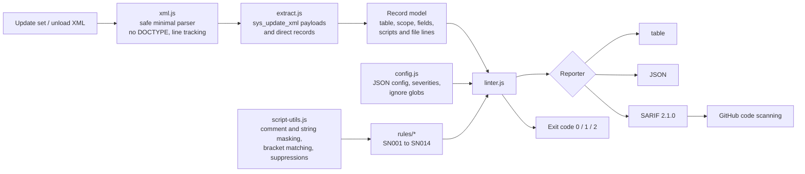

# servicenow-update-set-linter

[](https://github.com/akramservicenow-sketch/servicenow-update-set-linter/actions/workflows/ci.yml)


[](LICENSE)

A zero-dependency Node.js CLI that reads **exported ServiceNow update sets** (and single-record
"Export XML" unload files) and flags upgrade-risk, performance and security anti-patterns in
Business Rules, Client Scripts, Script Includes and UI Actions. It prints a human-readable table,
JSON, or **SARIF 2.1.0**, so findings can be shown in GitHub code scanning, and it returns CI-friendly
exit codes.

> **Disclaimer:** This is an independent, representative portfolio project built with synthetic data; not code from any employer or client. All example records, names and sys_ids are invented.

---

## Contents

- [The problem](#the-problem)
- [Why it matters on heavily customized instances](#why-it-matters-on-heavily-customized-instances)
- [Rule catalog](#rule-catalog)
- [Install](#install)
- [Usage](#usage)
- [Configuration](#configuration)
- [CI integration](#ci-integration)
- [Sample output](#sample-output)
- [Architecture](#architecture)
- [Security considerations](#security-considerations)
- [Limitations](#limitations)
- [Roadmap](#roadmap)
- [Rule reference](#rule-reference)

## The problem

ServiceNow changes usually move between instances as **update sets**. Code review often happens
inside the instance, record by record, if it happens at all. Patterns that look harmless in one
record cause trouble later:

- a `current.update()` in an *after* Business Rule that re-fires every rule on the table,
- a `GlideRecord` in a client script that makes a synchronous round trip on every field change,
- a hard-coded `sys_id` that points at a group that does not exist after the next clone,
- `gs.log()` in a scoped app, which fails at runtime because the API is not available there.

Exporting the update set to XML and linting it **before** it is committed to source control or
promoted gives reviewers a consistent, automated first pass.

## Why it matters on heavily customized instances

On instances with years of customization, each upgrade has to deal with a large number of skipped
records and custom scripts. The cost of an anti-pattern goes up over time:

- **Upgrade risk:** DOM manipulation, global Business Rules and synchronous client calls are the
  usual causes of breakage when the UI framework changes (UI16, Service Portal, Next Experience).
- **Performance:** nested queries, unfiltered queries and `getRowCount()` are hard to notice on a
  sub-production instance with little data, and slow in production.
- **Recursion and data integrity:** `current.update()` in before/after rules and unfiltered
  `updateMultiple()`/`deleteMultiple()` calls cause cascading writes and audit noise.
- **Portability:** hard-coded sys_ids tie code to one instance's reference data.

Running these checks in CI makes the rules consistent across teams and keeps the backlog of
technical debt from growing.

## Rule catalog

| ID | Name | Default | Applies to | What it catches |
|----|------|---------|------------|-----------------|
| SN001 | `br-current-update` | error | Business Rules (before/after) | `current.update()`: redundant write / recursion |
| SN002 | `client-gliderecord` | error | Client Scripts, client UI Actions | `new GlideRecord()` in browser code |
| SN003 | `client-synchronous-ajax` | error | Client Scripts, client UI Actions | `getXMLWait()`, `g_form.getReference()` without callback |
| SN004 | `hardcoded-sys-id` | warning | All | 32-hex sys_id string literals (allow-list supported) |
| SN005 | `scoped-gs-log` | error | Server scripts in scoped apps | `gs.log/print/logError/logWarning`, which scoped apps cannot call |
| SN006 | `leftover-debug-logging` | note | All | `console.log`, `gs.print`, global `gs.log`, `jslog`, `alert` |
| SN007 | `nested-gliderecord-query` | warning | Server scripts | `new GlideRecord/GlideAggregate` inside `while`/`for`/`do`/`forEach` |
| SN008 | `missing-set-limit` | warning | Server scripts | `query()` + `if (gr.next())` single-row lookup without `setLimit(1)` |
| SN009 | `unfiltered-query` | warning | Server scripts | `query()`/`updateMultiple()`/`deleteMultiple()` with no filter |
| SN010 | `no-eval` | error | All | `eval()`, `new Function()`, `GlideEvaluator` |
| SN011 | `client-dom-manipulation` | warning | Client Scripts, client UI Actions | `document.*`, `gel()`, `$()`, `$j()`, `jQuery()`, `innerHTML` |
| SN012 | `global-business-rule` | warning | Business Rules | Rules on the `global` table |
| SN013 | `empty-catch` | warning | All | `catch (e) {}` (including comment-only bodies) |
| SN014 | `getrowcount-for-counting` | note | Server scripts | `getRowCount()` used to count rows |

Run `sn-lint --list-rules` to print the catalog from the installed version. More detail on each
rule is in the [rule reference](#rule-reference).

## Install

Requires **Node.js 18.3 or later**. There are no runtime dependencies.

```bash
# from a clone
git clone https://github.com/akramservicenow-sketch/servicenow-update-set-linter.git
cd servicenow-update-set-linter
npm test                         # optional: run the test suite
npm link                         # optional: put `sn-lint` on your PATH

# or run directly without installing
node bin/sn-lint.js examples/

# or with Docker
docker build -t sn-lint .
docker run --rm -v "$PWD:/work" sn-lint examples/
```

## Usage

Export an update set from your instance (**System Update Sets > Retrieved/Local Update Sets >
Export to XML**) or export individual records (**list context menu > Export > XML**), then:

```bash
sn-lint path/to/update-set.xml                   # table output, exit 1 on errors
sn-lint exports/ --format json -o report.json    # whole directory, JSON report
sn-lint exports/ --format sarif -o sn-lint.sarif # SARIF for GitHub code scanning
sn-lint exports/ --fail-on warning               # stricter gate
sn-lint exports/ --fail-on none                  # report only, never fail
```

| Option | Description |
|--------|-------------|
| `-f, --format <table\|json\|sarif>` | Output format (default `table`) |
| `-o, --output <file>` | Write the report to a file |
| `-c, --config <file>` | Config file (default `./sn-lint.config.json` if present) |
| `--fail-on <note\|warning\|error\|none>` | Severity that causes exit code 1 (default from config, else `error`) |
| `--no-color` | Disable ANSI colours (also honours `NO_COLOR`) |
| `--list-rules` | Print the rule catalog |

**Exit codes:** `0` = no findings at or above the threshold, `1` = findings at or above the
threshold, `2` = usage/config error or a file that could not be parsed.

### Inline suppression

Some findings are intentional. To suppress one, add a reviewed comment in the script:

```javascript
// Approved exception: platform-owned record, identical on every instance.
// sn-lint-disable-next-line SN004
var ADMIN_GROUP = 'c0ffee000000000000000000000000bb';

doSomething(); // sn-lint-disable-line SN006, SN014
```

A directive without rule ids suppresses all rules on that line. Use it sparingly.

### Programmatic API

```javascript
const { lintText, resolveConfig, formatSarif } = require('servicenow-update-set-linter');

const config = resolveConfig({ rules: { SN014: 'off' } });
const result = lintText(xmlString, 'my-update-set.xml', config);
console.log(result.findings);
```

## Configuration

Copy [`sn-lint.config.example.json`](sn-lint.config.example.json) to `sn-lint.config.json` (it is
git-ignored by default, so commit it explicitly if the team shares one):

```json
{
  "failOn": "error",
  "ignoreRecords": ["Vendor *"],
  "rules": {
    "SN001": "error",
    "SN004": { "severity": "warning", "options": { "allow": ["c0ffee000000000000000000000000bb"] } },
    "leftover-debug-logging": "warning",
    "SN014": "off"
  }
}
```

- Rules can be keyed by **id** (`SN004`) or **name** (`hardcoded-sys-id`).
- Each value is `"off"`, `"note"`, `"warning"`, `"error"`, `true`/`false`, or
  `{ "enabled", "severity", "options" }`.
- `ignoreRecords` takes simple `*`/`?` globs matched against record names (case-insensitive).
- Unknown rules or invalid severities fail fast with exit code 2, so typos are caught.

## CI integration

### GitHub Actions with code scanning

```yaml
name: ServiceNow update set lint
on: [pull_request]

jobs:
  sn-lint:
    runs-on: ubuntu-latest
    permissions:
      contents: read
      security-events: write   # required to upload SARIF
    steps:
      - uses: actions/checkout@v4
      - uses: actions/checkout@v4
        with:
          repository: akramservicenow-sketch/servicenow-update-set-linter
          path: .sn-lint
      - uses: actions/setup-node@v4
        with:
          node-version: 20
      - name: Lint exported update sets
        run: node .sn-lint/bin/sn-lint.js update-sets/ --format sarif -o sn-lint.sarif --fail-on none
      - uses: github/codeql-action/upload-sarif@v3
        with:
          sarif_file: sn-lint.sarif
          category: sn-update-set-lint
      - name: Gate on errors
        run: node .sn-lint/bin/sn-lint.js update-sets/ --fail-on error
```

The SARIF output includes rule metadata, severity levels, file/line regions mapped back into the
exported XML (including scripts nested in escaped `<payload>` elements), a logical location
(`table/sys_id`) and stable `partialFingerprints`, so code scanning can track findings across
runs.

This repository's own [`ci.yml`](.github/workflows/ci.yml) runs the tests on Node 18 and 20,
lints the examples, requires zero findings on the clean example, and uploads the SARIF report as a
build artifact.

### Other CI systems

Any system that runs a container can use the Docker image:

```bash
docker run --rm -v "$PWD:/work" sn-lint update-sets/ --fail-on error
```

## Sample output

From [`docs/sample-output.txt`](docs/sample-output.txt) (regenerate with `npm run sample-output`):

```text
examples/sample-update-set.xml  (update set: DEMO-1042 Incident enhancements (synthetic))
  LINE   SEVERITY RULE   RECORD                                      MESSAGE
  18:5   note     SN006  Business Rule: Sync child tasks on update   gs.log() writes unconditionally to the system log. ...
  23:19  warning  SN007  Business Rule: Sync child tasks on update   new GlideRecord() inside a loop issues one query per iteration (N+1). ...
  29:5   error    SN001  Business Rule: Sync child tasks on update   current.update() in an after Business Rule re-runs before/after rules ...
  48:40  warning  SN004  Business Rule: Default VIP assignment g...  Hard-coded sys_id 'c0ffee000000000000000000000000aa'. ...
  93:15  error    SN002  Client Script: Validate caller location     Client-side GlideRecord performs a synchronous server call ...
  98:7   error    SN003  Client Script: Validate caller location     getXMLWait() blocks the browser until the server responds ...
  149:20 error    SN010  Script Include: LegacyRoutingUtils          eval() executes arbitrary code. ...
  188:9  error    SN005  Script Include: WorkOrderHelper             gs.log() is not available in scoped application 'x_demo_fieldsvc'. ...
  ...
26 problem(s) (8 error(s), 13 warning(s), 5 note(s)) in 14 record(s) across 3 file(s)
```

`examples/clean-update-set.xml` contains the same intent written with recommended patterns
(GlideAjax with a callback, GlideAggregate, a single `IN` query, system properties, scoped logging)
and produces zero findings.

## Architecture



- **Parser:** a small, purpose-built XML reader. Each element records its start line and text line,
  and nested payloads are parsed with a line offset, so a finding in a script inside an escaped
  `<payload>` still points at the right line of the exported file.
- **Rules:** each rule is a small module (`id`, `name`, `defaultSeverity`, `tables`, `check()`).
  Rules run against copies of the script where comments, and optionally string contents, are
  blanked out with offsets preserved. This avoids false positives from commented-out code without
  needing a full JavaScript parser.
- **Reporters** are pure functions of the results, which keeps them easy to test.

```
bin/sn-lint.js          CLI entry point
src/cli.js              argument parsing, config loading, output, exit codes
src/xml.js              XML parser
src/extract.js          record extraction from update sets and unload files
src/script-utils.js     masking, position mapping, suppressions
src/linter.js           rule execution, sorting, summary, exit code
src/config.js           config resolution and validation
src/rules/              one file per rule
src/reporters/          table, json, sarif
scripts/generate-examples.js  builds the synthetic example XML
```

## Security considerations

- **Untrusted input:** update set XML from another team or vendor is treated as untrusted. The parser
  rejects `DOCTYPE`/entity declarations (no XXE or entity-expansion attacks), never fetches external
  resources, and **never executes the scripts it analyses**. It only pattern-matches text.
- **No network access and no instance credentials:** the tool works only on exported files. It does
  not connect to a ServiceNow instance, so there are no credentials to store or leak.
- **Sensitive content in exports:** update sets can contain data you would not want in a public
  repository (for example, values in system properties or hard-coded endpoints). Review exports before
  committing them, and keep SARIF artifacts in private repositories when the code is proprietary.
- **Zero dependencies:** this removes supply-chain risk from transitive npm packages. The Docker image
  runs as the unprivileged `node` user.
- **SN010** flags dynamic code execution, the most common route to script injection.

## Limitations

- **Pattern-based, not a full JavaScript parser.** Comments and strings are masked, but regex
  literals are not detected, and variable tracking is per script and name-based (aliasing or
  reassignment is not followed). Expect occasional false positives and false negatives, and use
  suppressions or config to tune.
- **Script fields only.** The `script` field of the four supported tables is analysed. Conditions,
  UI Policies, UI Scripts, Scripted REST resources, Fix Scripts, Flow Designer inline scripts and
  widgets are not covered yet.
- **Column numbers** on the first line of a script are relative to the script, not the XML line;
  SARIF omits `startColumn` in that case.
- **Scope detection** relies on the `sys_scope` field in the export.
- Not a replacement for ServiceNow's own **Instance Scan** or for human code review. It is designed to
  run earlier, outside the instance, and in source control pipelines.

## Roadmap

- [ ] Additional tables: `sys_ui_script`, `sys_ui_policy`, `sys_ws_operation`, `sys_script_fix`, `sp_widget`
- [ ] Optional AST mode (e.g. Acorn) behind a flag for more precise variable tracking
- [ ] Rules: `GlideRecord.get()` without checking the return value, `setWorkflow(false)` without
      justification, client scripts missing an `isLoading` guard, `current.operation()` misuse
- [ ] Baseline file to accept existing findings and fail only on new ones
- [ ] Update set-level checks (mixed scopes, DELETE of OOB records, collision hints)
- [ ] Publish to npm and GitHub Container Registry

## Rule reference

### SN001 br-current-update
Calling `current.update()` in a **before** rule writes the record twice (the platform already saves
changes made to `current`). In an **after** rule it starts a new update cycle that re-runs before
and after rules, which can lead to recursion. Set field values in a before rule instead.
Async rules are not flagged.

### SN002 client-gliderecord
Client-side `GlideRecord` makes a synchronous call, returns every field the user can read, and is not
available in Service Portal. Use `GlideAjax` with a client-callable Script Include that returns only
what is needed. Client UI Actions that contain a `typeof window == 'undefined'` server branch are
skipped.

### SN003 client-synchronous-ajax
`getXMLWait()` and `g_form.getReference(field)` without a callback freeze the browser while the server
responds. Use `getXMLAnswer(callback)` and `getReference(field, callback)`.

### SN004 hardcoded-sys-id
sys_ids of reference data (groups, users, catalog items) differ between instances unless the data is
moved with the code. Use a system property, a lookup by a stable key, or a decision table. Use the
`allow` option for genuine constants.

### SN005 scoped-gs-log
`gs.log()`, `gs.print()`, `gs.logError()` and `gs.logWarning()` are not available in scoped
applications. Use `gs.info()`, `gs.warn()`, `gs.error()` or `gs.debug()`.

### SN006 leftover-debug-logging
Debug output left in production code fills the system log and the browser console. In global scope,
`gs.log()` is reported here as a note, because it is often used intentionally.

### SN007 nested-gliderecord-query
Creating a query inside a loop runs one database query per iteration (the N+1 pattern). Collect the
keys and run a single query with `addQuery(field, 'IN', list)`, use a join (`addJoinQuery`), or use
`GlideAggregate`.

### SN008 missing-set-limit
`if (gr.next())` reads only the first row, but without `setLimit(1)` the database may still prepare
the whole result set.

### SN009 unfiltered-query
`query()` with no filter reads the whole table. `updateMultiple()` or `deleteMultiple()` with no
filter changes **every row**.

### SN010 no-eval
Dynamic code execution makes code hard to review and opens the door to script injection when the
evaluated string can contain user input.

### SN011 client-dom-manipulation
Form markup is not a public API. DOM access breaks during UI upgrades and does not work in Service
Portal or Next Experience workspaces. Use `g_form` methods (`setDisplay`, `showFieldMsg`, `flash`,
`addDecoration`, and so on).

### SN012 global-business-rule
Rules on the `global` table load for every table and transaction. Move shared functions into a
Script Include.

### SN013 empty-catch
Swallowed exceptions hide failures. Log them with context, or rethrow.

### SN014 getrowcount-for-counting
`getRowCount()` retrieves the result set to count it. `GlideAggregate` with `COUNT` lets the database
do the counting.

## License

[MIT](LICENSE) © 2026 Shaik Akram
